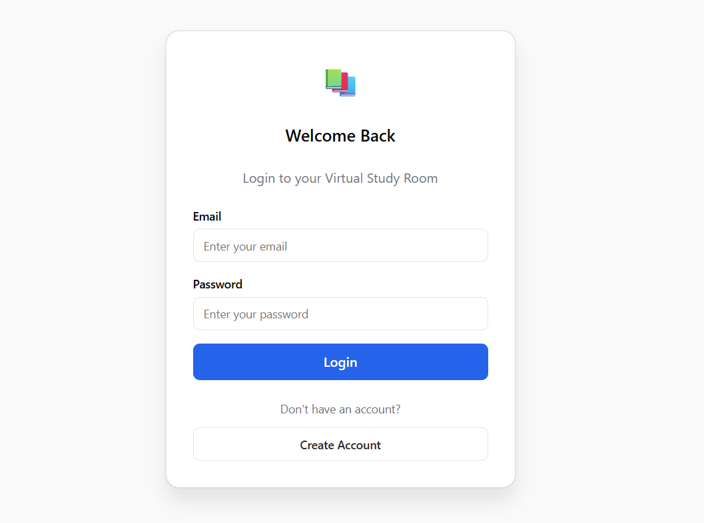
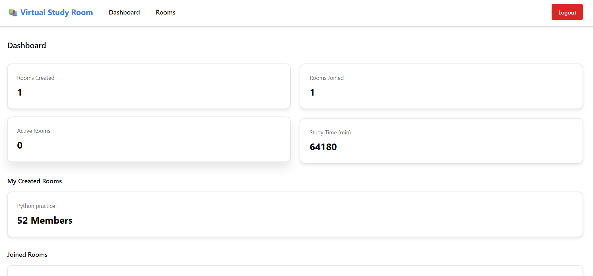
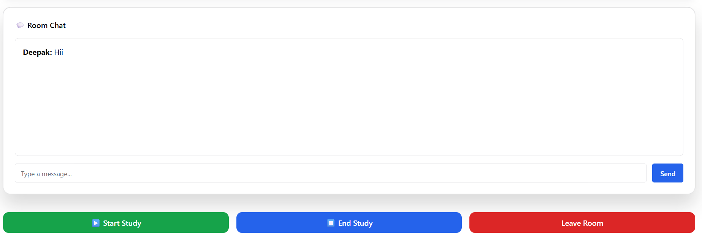

\# Virtual Study Room 🚀


A full-stack collaborative study platform that allows users to create and join study rooms with real-time communication.


\## 📌 Overview


Virtual Study Room is a web application designed to provide a collaborative environment where students can study together, communicate through real-time chat, and manage study rooms.


\## ✨ Features


\- User registration and authentication

\- JWT-based secure login system

\- Create and join study rooms

\- Real-time chat using Socket.IO

\- Room management

\- Persistent message storage

\- Responsive user interface

## 📸 Screenshots

### Login Page


### Dashboard


### Study Room Chat


\## 🛠️ Tech Stack


\### Frontend

\- React

\- TypeScript

\- Vite

\- Chakra UI

\- Axios

\- Socket.IO Client


\### Backend

\- Node.js

\- Express.js

\- TypeScript

\- JWT Authentication

\- Socket.IO


\### Database

\- MariaDB


\### Deployment

\- Frontend: Vercel

\- Backend: Render


\## 🏗️ Project Structure


virtual-study-room

│

├── client # React frontend

│

└── server # Node.js backend


\## ⚙️ Installation


\### Clone Repository


```bash

git clone <repository-url>


Frontend Setup

cd client

npm install

npm run dev


Backend Setup

cd server

npm install

npm run dev


🔐 Environment Variables


Create .env files in both frontend and backend according to your configuration.


🚀 Deployment


Frontend is deployed using Vercel.


Backend is deployed using Render.


🔮 Future Enhancements

Video study rooms

Screen sharing

Pomodoro timer

File sharing

AI study assistant

Study analytics


👨‍💻 Author

Deepak Gouda

